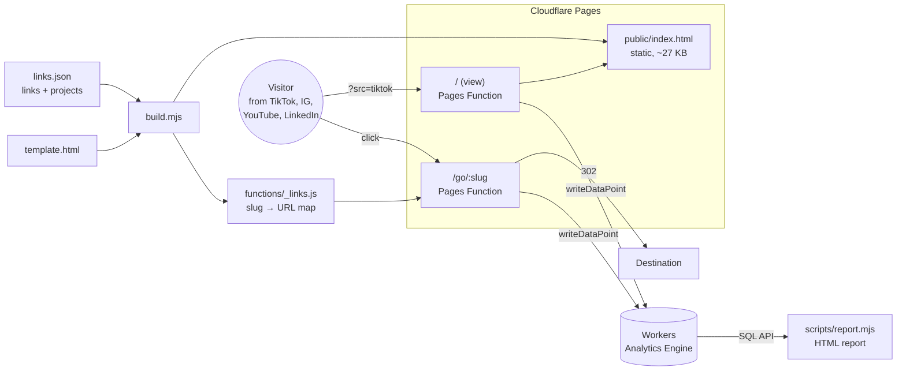

<p align="center"></p>

# mridulmerges.ca

My corner of the internet: every link I share, the things I'm building, and a little about me. Live at **[mridulmerges.ca](https://mridulmerges.ca)**.

## Why I built it

I post a short tech episode every day, and every bio pointed at a Linktree. It worked, but it wasn't *mine*: I couldn't shape how it looked, I couldn't show what I'm building, and I couldn't see which video actually sent people over. I teach people how software works, so it felt wrong not to build my own. This is that: one fast page I own end to end, with analytics I can query myself and no third-party trackers.

## How it works



- **One source of truth.** Links and projects live in `links.json`. `node build.mjs` renders the page and the redirect map, and fails the build on any unfilled placeholder.
- **Tracked links without trackers.** Every outbound link goes through `/go/<slug>`, a Pages Function that logs one data point (link, country, device, referrer, `?src=` tag, bot or human) and answers with a 302. Nothing is set in the browser: no cookies, no client-side scripts.
- **Source attribution.** Each platform's bio uses its own tag (`?src=tiktok`, `ig`, `yt`, `li`, `gh`), so I can tell which platform actually sends people.
- **Reports on demand.** `node scripts/report.mjs 28` queries the Analytics Engine SQL API and writes a one-page HTML report: visits, clicks, click-through, sources, top links, countries, devices. `--demo` renders sample data.
- **Fast by default.** Static HTML, self-hosted Inter and IBM Plex Mono, responsive WebP portraits, no framework, and motion that respects `prefers-reduced-motion`.

## Impact

| | |
|---|---|
| Replaced | Linktree in every bio (TikTok, Instagram, YouTube, LinkedIn, GitHub) |
| Lighthouse (mobile) | Performance 99 · Accessibility 100 · Best practices 100 · SEO 100 |
| Page weight | ~90 KB total transfer, including fonts and portrait |
| Third-party scripts | 0 |
| Analytics | Every click and visit, by platform, queryable with SQL |

<sub>Lighthouse 12, mobile preset, measured 2026-11-16 on the built page.</sub>

## Run it

```bash
node build.mjs                      # build public/ and functions/_links.js
npx wrangler pages dev public       # local preview with Functions
npx wrangler pages deploy --branch main
CF_ACCOUNT_ID=… CF_API_TOKEN=… node scripts/report.mjs 28
```

Side projects live on their own subdomains, starting with [Switchboard](https://switchboard.mridulmerges.ca).

---

Plant a seed today, grow a better tomorrow.
